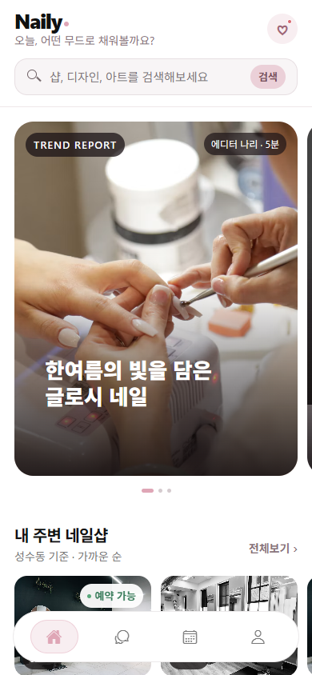

# Naily · 네일리

Expo · React Native · TypeScript로 만든 네일 디자인 탐색, 샵 비교, 로컬 예약, 커뮤니티 앱입니다. **AI 코딩 도구를 활용해 전체 개발을 진행한 개인 바이브코딩 프로젝트**이며, 기능 연결과 상태 관리, 글·사진 편집 경험을 포트폴리오로 보여줍니다.



## 실행

Node.js 22 이상과 npm이 필요합니다. 검증 환경은 Node 24.14.1입니다.

```bash
git clone https://github.com/sso1o/naily.git
cd naily
npm ci
npm run web
```

개발 서버가 표시하는 주소를 브라우저에서 엽니다. 정적 배포 형태로 확인하려면:

```bash
npm run build:web
npm run preview
```

미리보기: http://127.0.0.1:9081 · 포트 변경: 환경변수 PORT. 호스팅할 때 모든 앱 경로를 index.html로 연결하는 SPA fallback 설정이 필요합니다. API 키나 서버 설정 없이 로컬 체험이 가능합니다.

## 체험 순서

1. 홈 → 검색에서 디자인/샵/글을 검색하고 필터·정렬을 적용합니다.
2. 디자인 상세 → 사진 전체보기 → 저장 → 가능한 샵 → 예약하기를 엽니다.
3. 디자인·샵·날짜·시간 선택 → 예약 저장 → 마이페이지에서 내역 확인·취소합니다.
4. 마이페이지 → 샵 대시보드 → 미리보기에서 해당 샵의 예약을 승인하고 방문 완료 처리합니다. 같은 샵 시간 또는 본인 일정의 중복 예약은 거절됩니다. 취소한 시간은 다시 예약할 수 있습니다.
5. 커뮤니티 → 글쓰기 → 글·사진·꾸미기·장소·투표 추가 → 미리보기 → 등록 → 수정·댓글·답글·좋아요·저장을 체험합니다.
6. 샵 상세에서 저장과 문의를 남기고, 대시보드 → 고객 문의에서 로컬 답변을 작성합니다.
7. 마이페이지에서 저장한 디자인·내 글·좋아요한 글·저장한 글·관심 샵, 프로필 설정을 확인합니다. 새로고침 후에도 저장한 데이터가 유지됩니다.

## 구현 범위

| 영역 | 동작 |
| --- | --- |
| 탐색 | 샘플 디자인·샵·매거진·커뮤니티, 검색·필터·정렬·갤러리·지도 링크 |
| 예약 | 샵별 디자인 제한, 날짜/시간 검증, 기기 내 중복 방지, 접수 대기→확정→방문 완료 또는 취소 |
| 커뮤니티 | 블록 글 작성/수정, 서식, 사진 꾸미기, undo/redo, 영상·장소·투표, 댓글·답글·저장·좋아요·팔로잉 |
| 개인 화면 | 실제 선택한 저장 목록과 내 활동, 닉네임 편집, 예약 상태 알림 |
| 샵 화면 | 로컬 관리자 미리보기, 가격·공지·이달의 아트 편집, 제공 디자인 지정, 문의 답변, 리뷰 열람·답변 |
| 저장 | Web localStorage / Native 앱 문서 디렉터리 JSON, 사진·영상의 로컬 보관 |

**현재 범위는 한 기기에서 동작하는 포트폴리오 체험 앱입니다.** 샵·사용자·거리·평점·홈 지표는 예시 자료입니다. 예약과 문의는 실제 샵에 전송되지 않습니다. 실제 로그인·다중 사용자 서버·결제·사업자 인증·외부 푸시는 연결되어 있지 않습니다. 샵 미리보기는 인증/접근 통제 기능이 아닙니다. 이 제한을 실제 서비스 연동 완료로 표현하지 않습니다.

웹에서 선택한 미디어는 data URL로 저장하며 파일별 2MB 이하를 허용합니다. 브라우저 전체 저장 용량 제한을 초과하면 저장이 실패할 수 있습니다. 네이티브는 선택한 미디어를 앱 문서 디렉터리에 복사합니다. 저장소 삭제·앱 제거 시 데이터가 사라지며, 여러 기기/탭 사이 동기화는 제공하지 않습니다. 미등록 편집 내용은 이탈 확인으로 보호하고, 게시한 글이 영구 저장됩니다. 외부 샘플 이미지는 인터넷 연결이 필요합니다.

## 검증

```bash
npm run typecheck
npm test
npm run build:web
```

테스트 76개는 예약 검증·상태 전이·저장 재로드·저장소 실패, 반응·댓글, 편집기·사진 조작·이탈 보호·검색/피드 동작 등을 검사합니다. 실제 브라우저 검증과 플랫폼별 한계는 [검증 기록](docs/project-status.md)을 참고해주세요. iOS/Android 실기기 검증을 완료했다고 주장하지 않습니다.

## 구조

- `app/`: Expo Router 화면과 URL 경로
- `components/`, `hooks/`: 공통 UI, 편집기, 반응과 제스처 상태
- `services/`: 예약·검색·글·편집·저장 로직
- `data/`: 샘플 자료와 기기 저장 상태, `types/`: 모델
- `tests/`: Node 테스트, `scripts/preview.cjs`: 정적 웹 미리보기
- `docs/`: 구조·구현 범위·검증 기록, 과거 개발 기록

[구조 설명](docs/architecture.md) · [포트폴리오 설명](docs/portfolio.md) · [개발 안내](docs/development.md)

원본 개인 프로젝트: thdnjs0730/Naily. 기존 로컬 구현을 보존한 사본에서 포트폴리오 버전을 완성했습니다. AI 도구를 사용한 개발 과정과 기존 개인 구현을 명시하며, 외부 이미지·폰트·라이브러리의 권리는 각 제공자에게 있습니다. 샘플 사진은 코드에 표시한 Unsplash URL, 폰트는 Nanum Myeongjo 패키지를 사용합니다.
