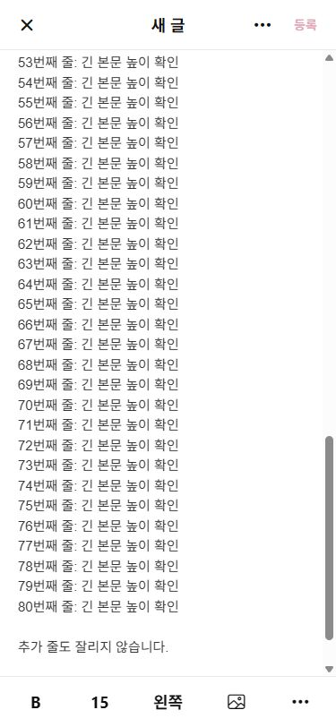

# 커뮤니티 본문 편집 수정 (2026-10-04)

## 조사와 원인

현재 구현은 리치 텍스트 라이브러리가 아닌 `PostBlock[]`와 여러 React Native TextInput이었다. 굵기/크기/정렬 버튼은 블록 속성만 변경하므로 선택한 글자나 커서 이후 입력을 표현할 데이터가 없었다. 오른쪽 정렬도 타입과 버튼 순환에 없었다.

본문은 이미 바깥 ScrollView 안에 있었지만 `WritingTextInput`이 모든 multiline 입력에 `numberOfLines={1}`을 지정하고, `onContentSizeChange` 결과로 네이티브 height를 지정했다. 설치된 RN Android `ReactTextInputManager.setNumLines`는 `view.setLines(numLines)`를 호출한다. 따라서 한 줄 제한과 자동 높이를 함께 사용하는 설정이었으며, 제한된 측정값을 다시 높이에 반영하면 글이 늘어도 입력 영역이 충분히 늘지 않는다. `scrollEnabled={false}`까지 결합되어 숨은 줄을 내부 스크롤로 볼 수도 없는 구조였다. iOS에서 같은 원인을 실기기로 재현했다고 주장하지 않는다.

해당 줄 제한을 제거했다. 본문은 선택 범위를 지원하기 위해 텍스트 입력 부분만 contenteditable 엔진으로 교체했다. 이미지/사진 재배치/꾸미기/미리보기/등록 서비스는 기존 구조를 사용한다. 네이티브는 `react-native-webview`, 웹은 동일 HTML 엔진을 iframe에 로드한다. 본문에는 내부 스크롤을 사용하지 않고 ResizeObserver의 실제 문서 높이로 컨테이너를 늘린다. 48px은 최소 높이이며 최대 높이는 없다.

## 변경 파일

- `components/BlogEditor.tsx`: 문단 추가·소제목 추가·구분선 추가 및 텍스트 블록 이동·삭제 메뉴 제거. 하단 서식 명령 연결. 실제 커서 좌표가 바깥 스크롤의 표시 범위를 벗어날 때만 스크롤. 사진 추가 뒤 빈 본문 입력을 제공. 사진 이동/꾸미기 유지.
- `components/RichWritingInput.tsx` (추가): WebView/iframe 브리지, 선택 영역 보존, 입력 높이 동기화, 서식·포커스 명령.
- `services/richWriting.ts` (추가): 기존 인접 텍스트/소제목의 서식을 보존하며 병합, 글자별 데이터와 줄 정렬 변환, HTML 이스케이프. 선택 범위와 커서 이후 서식, IME 조합 중 명령 지연, plain-text 붙여넣기, 높이·커서 보고.
- `components/EditorToolbar.tsx`: 굵기/크기/왼쪽·가운데·오른쪽 정렬/사진/사진 메뉴. 태그 버튼 제거.
- `components/WritingTextInput.tsx`: 공통 multiline 한 줄 제한 제거. 제목/태그의 기존 자동 높이 유지.
- `components/PostBlockRenderer.tsx`: 글자별 크기·굵기와 줄별 정렬을 미리보기/상세에서 렌더링. 기존 블록도 지원.
- `types/models.ts`: 선택적인 `runs` 필드 및 오른쪽 정렬. 기존 content 필드는 계속 저장.
- `services/postDraft.ts`: 편집 진입 시 서식 데이터를 독립 복사, 기존 인접 텍스트 병합, 이미지 뒤 입력 영역 보장.
- `app/write.tsx`: 본문 아래 직접 태그 입력. 태그 시트 제거. iOS KeyboardAvoidingView padding 유지; Android는 시스템 resize를 사용해 중복 높이 보정을 피함.
- `app.json`: Android `softwareKeyboardLayoutMode: resize` 명시.
- `package.json`, `package-lock.json`: `react-native-webview` 추가.
- `tests/writing.test.cjs`, `tests/document-editing.test.cjs`, `tests/rich-writing.test.cjs`: 새 데이터/에디터 연결에 맞춰 회귀 검사 갱신, 부분 서식·저장·편집 복원·정렬·이스케이프 검사 추가.

기존 작업 트리에 있던 다른 변경은 보존했다. 현재 저장은 기존 로컬 메모리 데모 세션이다. 전체 페이지 새로고침이나 앱 재시작 후 데이터 영속 저장은 이번 작업에서 추가하지 않았다.

## 검증

- TypeScript 검사 통과.
- 전체 자동 검사 50개 통과: 저장/수정, 꾸미기 취소·완료, 사진 순서와 장식 보존, 입력 높이, 서식 명령 및 저장 후 독립 복원 포함.
- Expo Android/iOS/web export 통과. 네이티브 설치·실기기 실행 검증을 의미하지 않는다.
- 변경한 tracked 파일 diff 공백 검사 통과.
- 웹 UI: 부분 선택 굵기·18px 적용, 커서 이후 18px 입력, 선택 줄 가운데·오른쪽 정렬, 게시 후 상세에서 18px/700과 오른쪽 정렬 확인.
- 375×812 웹: 80줄 입력에서 본문 1,804px, 태그는 본문 끝보다 16px 아래. 81번째 줄 입력 후 본문 1,827px, 마지막 줄이 하단 툴바 위에 표시됨.
- 최종 화면에서 80줄 뒤 Enter 두 번과 추가 입력도 확인했다. 본문 1,849px, 본문 끝 738px/태그 시작 754px. 브라우저 error 로그 없음.
- 새 게시물 저장→수정 복원은 서비스 통합 검사로 검증했다. 기존 게시물의 편집 화면은 웹으로 확인했다. 로컬 세션 저장은 전체 페이지 이동/새로고침 시 초기화되므로 그 동작을 영속 저장으로 보고하지 않는다.

## 기기에서 남은 확인

Android/iOS 키보드가 열린 상태의 긴 본문 Enter/커서 이동, 한글 IME 조합과 서식 변경, 실제 사진 핸들 길게 누르기와 드래그, 꾸미기 왕복을 실기기로 확인해야 한다. 두 플랫폼의 핵심 편집 코드는 동일하지만 Android WebView와 iOS WKWebView의 선택/키보드 동작이 동일하다고 실측한 것은 아니다. 기존 development build를 사용하는 경우 새 네이티브 의존성과 Android 설정 반영을 위해 다시 빌드해야 한다.

