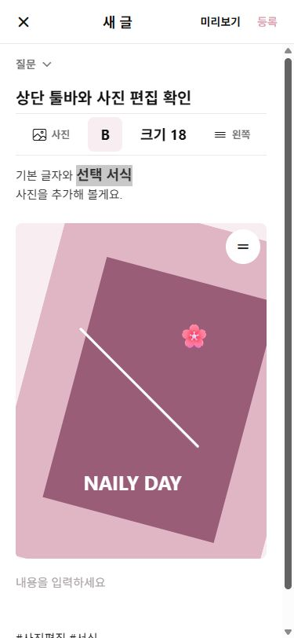
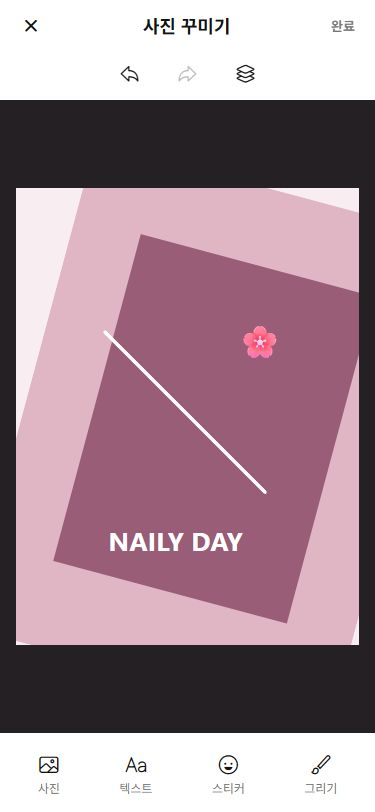
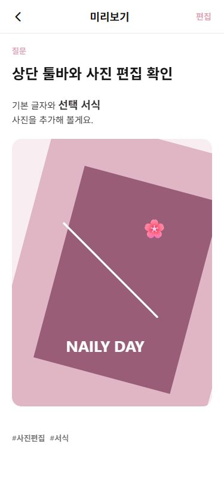
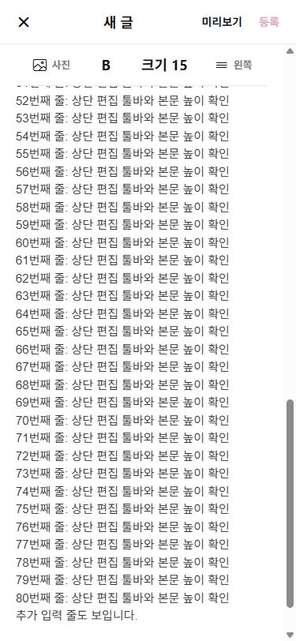

# 상단 글쓰기 툴바와 사진 캔버스 개편

2026-10-04. 작업 시작 시 현재 구현과 의존성을 다시 읽었으며 기존 작업 트리의 다른 변경은 보존했다.

## 기존 구조와 변경 후 구조

기존 글쓰기 화면은 제목/본문/태그가 들어 있는 하나의 ScrollView와 바깥 하단 툴바였다. 본문은 WebView/iframe의 contenteditable 엔진으로 선택 범위 서식을 지원했고, 사진은 `PostBlock`으로 관리했다. 사진을 선택하면 바로 본문에 넣은 후 별도로 꾸미기 화면을 열었다. 상단 더보기 시트에는 미리보기와 안내문만 있었다.

변경 후에는 제목 아래 ScrollView의 두 번째 자식에 툴바를 두고 `stickyHeaderIndices={[1]}`로 고정한다. 주요 기능은 사진/B/크기/정렬 네 가지다. 평소 한 줄이며 크기 선택 시에만 보조 행이 열린다. 하단 툴바·툴바 더보기·태그 버튼은 없다. 게시판 선택 시트는 그대로 유지하고 상단에 `미리보기` 텍스트 버튼을 직접 제공한다. 본문/이미지/태그는 같은 문서 스크롤을 사용한다. 실제 커서가 sticky 툴바 아래에 보이도록 상단 가림 높이도 계산한다.

사진 흐름은 사진 선택 → 사진 편집 캔버스 → 완료 → 본문 삽입이다. 미완료 사진은 본문 밖의 임시 데이터로 관리하므로 취소하면 삽입하지 않는다. 기존 사진은 탭 후 `사진 편집` 액션으로 다시 편집한다. 기존 사진의 교체도 편집 완료 후에만 반영한다.

## 변경 파일

| 파일 | 핵심 변경 |
| --- | --- |
| `components/BlogEditor.tsx` | 제목 아래 sticky 툴바, 상단 가림 높이 보정, 사진 선택 직후 편집으로 전달, 사진 편집 액션. 기존 사진 핸들·순서 메뉴·삭제 유지 |
| `components/EditorToolbar.tsx` | 사진/B/크기/정렬 한 줄, 짧은 라벨, 더보기 제거, 설정 안내문 제거 |
| `app/write.tsx` | 독립적인 미리보기 버튼, 불필요한 글 메뉴 시트 제거, 편집 완료한 새 사진만 최신 본문 상태에 삽입, 취소/재진입/중복 소비 방지 |
| `app/image-decorator.tsx` | 사진/텍스트/스티커/그리기 아이콘 도구, 8개 이모지 팔레트, 사진 자체 변형, 펜 색상·굵기, 그리기 실행 취소. 기존 텍스트 서식·삭제·복제·레이어 및 도형/그라데이션 추가 유지 |
| `components/DecoratedImage.tsx` | 사진 변형과 SVG 그리기 표시. 동일 컴포넌트를 작성/미리보기/상세/카드에서 사용. 사진 모드에서 장식 터치 분리, 그리기 선이 다른 요소 선택을 가로막지 않도록 처리 |
| `components/PhotoCanvasGestures.tsx` | 사진 drag/pinch/rotate, 단일 터치 그리기와 실시간 미리보기, 터치 개수 전환 시 기준 재설정, 다중 터치/중단/앱 비활성화 시 미완료 선 취소 |
| `services/decorationEditing.ts` | 사진 변형 계산, 그리기 좌표 정규화/샘플링/경로 생성, 그리기 좌표와 사진 변형 독립 복사 |
| `services/postDraft.ts` | 수정 진입 시 그리기 좌표와 사진 변형을 원본과 독립적으로 복사 |
| `types/models.ts` | 선택적인 `photoTransform`, `drawing` 장식의 points/strokeWidth 필드. 이전 데이터는 변형 없음/그리기 없음으로 표시 |
| `package.json`, `package-lock.json` | Expo SDK 57 호환 `react-native-svg` 15.15.4 고정 추가 |
| `tests/writing.test.cjs` | 편집 완료 전 삽입 금지·취소·최신 본문 보존, 독립 미리보기, sticky 툴바 검사 |
| `tests/document-editing.test.cjs` | 사진 변형의 취소·완료·undo/redo, 그리기 한 획 단위 기록, 스티커 추가·삭제 검사 |
| `tests/photo-canvas.test.cjs` | 실제 컴포넌트 responder의 그리기/취소/핀치/회전/손가락 전환, 좌표 배율과 독립 복사 검사 |
| `tests/fixtures/canvas-photo.png` | 로컬 사진 선택 흐름 검증용 합성 테스트 이미지 |
| `docs/community-editor-story-update.md` 및 `docs/story-*.png` | 이 보고서와 웹 검증 화면 |

## 본문 서식 데이터

기존 구현의 `content`와 선택적인 `runs`를 계속 사용한다. 각 run에는 text/fontSize/bold/align이 저장된다. `RichWritingInput`은 선택 범위를 유지해 명령을 실행하며, DOM의 실제 글자 스타일과 줄 정렬을 구조화한 데이터로 돌려준다. 커서만 있을 때는 이후 입력에 서식을 적용한다. HTML 자체를 게시물 데이터로 저장하지 않는다.

`PostBlockRenderer`는 미리보기와 실제 게시물 상세에서 공유된다. 기존 block 단위 서식 데이터도 계속 표시한다. 이전 작업에서 고친 자동 높이와 키보드 구조는 유지하며 본문 내부 스크롤이나 큰 고정 빈 영역을 추가하지 않았다. 본문 높이가 늘면 태그가 뒤로 밀린다.

## 사진 편집 구조와 저장 방식

사진의 이동 x/y는 캔버스 너비/높이에 대한 비율이다. scale은 0.5~4, rotation은 degree다. 텍스트·스티커는 기존 장식의 x/y/scale/rotation을 사용한다. 두 손가락 중심점·거리·각도 차이를 계산하고 손가락 수가 변하면 현 상태를 새 기준으로 삼아 튐을 줄인다. 시스템 가장자리 24dp에서는 제스처를 선점하지 않는다. 제스처 대체용 이동/확대/회전 버튼도 있다.

그리기는 한 획마다 `type:'drawing'` 장식으로 저장한다. 점 좌표는 0~1 범위이고, 굵기는 390dp 기준이며 렌더링 너비에 비례한다. 선은 둥근 끝과 연결을 갖는 SVG Path다. 이동 이벤트를 1.5px 간격으로 샘플링하고 한 획은 최대 2,048개 점으로 제한해 데이터 폭증을 줄인다. 손을 놓기 전에는 미리보기만 표시하고 완료한 한 획을 하나의 undo 기록으로 저장한다. 다중 터치·responder 중단·앱 비활성화는 미완료 획을 저장하지 않는다.

원본 URI와 편집 메타데이터를 함께 유지하는 방식을 선택했다. `완료`에서 독립 복사한 원본 URI+photoTransform+decorations를 임시 결과로 전달하고, 글쓰기 화면이 이를 한 번만 소비한다. 작성·미리보기·상세는 같은 DecoratedImage로 결과를 합성 표시하므로 다시 편집할 수 있다. **이번 작업에서는 평면 PNG/JPEG 파일을 별도로 생성하지 않는다.** 원본을 변경하거나 재인코딩하지 않는다.

조사한 프로젝트에는 Supabase 클라이언트/업로드/Storage 저장 흐름이 없고 기존 게시 서비스는 로컬 메모리 데모 세션이다. 존재하지 않는 Storage 연동을 연결했다고 보고하지 않는다. 재시작/전체 새로고침을 넘는 게시물·편집 결과 영속 저장은 기존과 동일하게 제공하지 않는다. 이미지 최대 개수 제한도 기존 코드에 없었다.

## 의존성과 Expo 호환성

새 의존성은 `react-native-svg` 하나다. 설치된 Expo 57.0.19의 `bundledNativeModules.json`에 명시된 15.15.4를 사용하고 package/lockfile에 고정했다. 자유 그리기 결과를 Android/iOS/web에서 같은 벡터로 표시하기 위해 추가했다. 기존 PanResponder와 히스토리를 사용하므로 Gesture Handler/Reanimated/Skia/ViewShot/ImageManipulator는 추가하지 않았다.

개발용 네이티브 빌드에는 새 SVG 모듈을 포함하도록 다시 빌드해야 한다. Expo Go에서는 해당 SDK 번들 모듈을 사용한다. Android의 기존 resize 설정 및 iOS KeyboardAvoidingView padding은 유지했다.

## 검증 결과와 한계

- `npm run typecheck`: 통과.
- `node --test tests/*.test.cjs`: 59개 통과.
- Expo Android/iOS/web export: 모두 통과.
- 변경한 tracked 파일 `git diff --check`: 통과.
- 웹 375×812: 사진/B/크기/정렬이 한 줄이며 미리보기 글자가 상단에 직접 표시됨.
- 일부 글자 선택 → 굵게/18px → 사진 선택/편집/완료 → 미리보기/게시: 게시 후 해당 글자의 computed style은 18px/700 유지.
- 실제 드래그로 SVG 선 생성 → undo 시 선 0개 → redo 시 1개. 스티커/텍스트 추가 및 직접 이동 확인.
- 사진 확대, 15° 회전 및 실제 drag 이동 확인. 완료 후 본문·미리보기·게시물 상세에서 같은 변형과 그리기/장식 표시.
- 미완료 새 사진에서 취소 → 본문 사진 핸들 0개, 본문 editor 1개. 제목과 기존 80줄+추가 입력이 그대로 보존됨.
- 긴 본문 80줄 뒤 Enter/추가 입력: 본문 height 1,827px, 본문 끝 796px/태그 시작 812px. 사진 버튼은 viewport y=60~104에 유지됨. Ctrl+Home으로 본문 시작으로 이동했을 때 입력 줄이 sticky 툴바 아래에 표시됨.
- 브라우저 error 로그 없음. 기존 RN Web shadow/pointerEvents deprecation 경고는 남아 있음.

Android/iOS **실기기 실행과 실제 두 손가락 입력은 이 환경에서 검증하지 못했다.** native export와 responder/변형 테스트 통과는 실제 키보드·한글 조합·핀치/회전·SafeArea·긴 사진 드래그의 기기 검증을 대체하지 않는다. 자동 검사에서는 기존 저장/수정/꾸미기 취소/순서 변경/삭제/서식 복원을 포함했으며, Supabase 업로드·Storage 회귀는 현재 연결 자체가 없어 검증 대상이 아니다.

