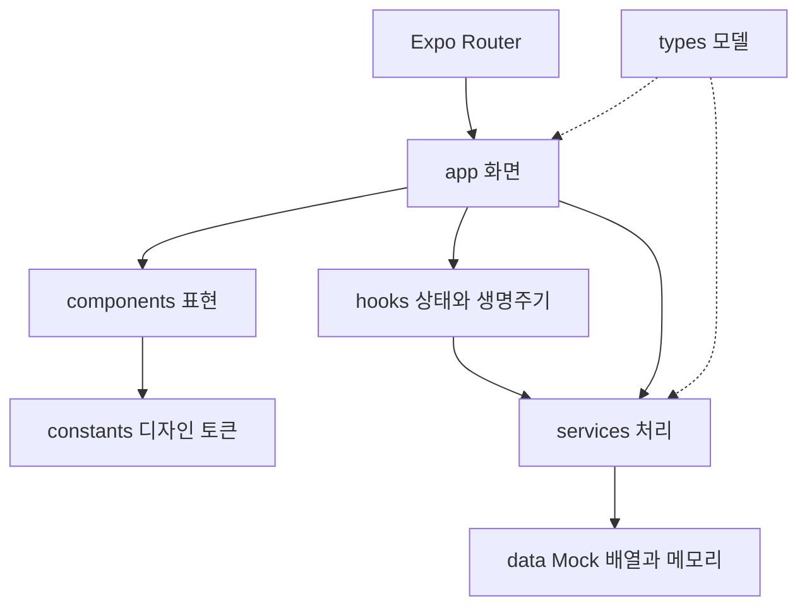
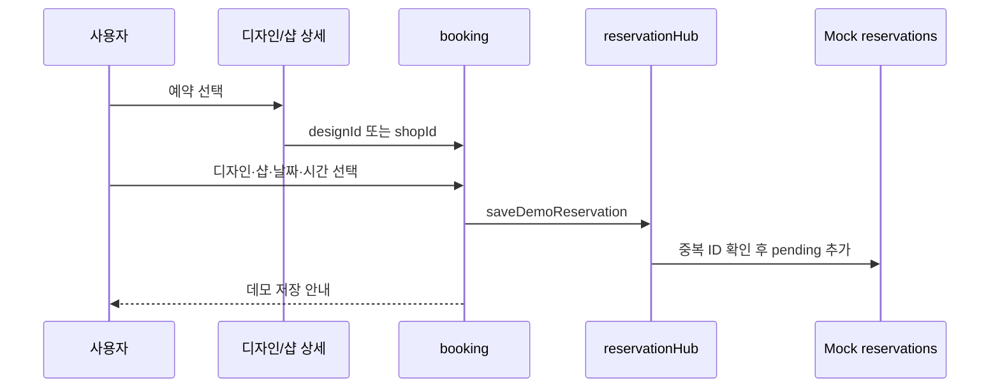

# Naily · 네일리 — 프로젝트 허브

기준일: 2026-10-04 · GitHub: https://github.com/thdnjs0730/Naily

이 문서는 Notion으로 가져올 Markdown 원본입니다. 파일 생성은 실제 Notion 게시와 별개입니다.


**네일 디자인 탐색, 네일숍 정보, 커뮤니티, 예약 과정을 하나의 흐름으로 연결한 앱 프로토타입.**

기준일: 2026-10-04, 현재 로컬 구현. 일부 변경은 아직 GitHub에 게시되지 않았습니다.

## 프로젝트 소개

사진으로 취향을 발견한 경험을 샵 탐색과 예약 선택으로 이어가도록 만든 프론트엔드 프로젝트입니다. 일반 사용자에게 디자인·샵 비교와 경험 공유를, 운영자에게 전용 커뮤니티와 대시보드 미리보기를 제공합니다.

Expo·React Native·TypeScript로 Android·iOS·Web을 대상으로 화면을 구성합니다. 현재는 Mock 데이터와 메모리를 사용하며 실제 운영 서비스가 아닙니다.

## 구현에서 보여줄 점

| 특징 | 구현 방식 | 설명할 가치 |
| --- | --- | --- |
| 연결된 탐색 | 디자인·샵·글 ID와 라우트 인자 | 상세·예약 사이 맥락 전달 |
| 블록형 콘텐츠 | PostBlock 배열·공통 렌더러 | 편집·미리보기·상세 재사용 |
| 사진 꾸미기 | 원본 URI·장식 객체·변환·레이어·이력 | 표현과 원본의 분리 |
| 상태 일관성 | 이탈 보호·중복 잠금·반응 구독·스냅샷 | 비동기·공유 데이터 문제 대응 |
| 공통 UI | 카드·버튼·헤더·의미별 글자 토큰 | 표현 일관성과 수정 위치 분리 |

이번 문서 작업에서 타입 검사와 기존 테스트 34개가 통과했습니다. 모킹 기반 검증이며 실기기 E2E 결과는 아닙니다. 구체적인 파일과 원리는 [아키텍처](architecture.md)에 있습니다.

## 5분 시연 순서

1. 홈의 매거진·이달의 아트·주변 샵과 상세 진입을 보여줍니다.
2. 검색에서 디자인·커뮤니티·샵 결과와 필터·정렬을 비교합니다.
3. 디자인 사진·관련 샵·샵 메뉴·월별 아트를 살펴봅니다.
4. 예약에 진입해 날짜·시간을 고르고 데모 저장 후 내역을 확인합니다.
5. 커뮤니티 글의 제목·본문·태그와 사진을 작성하고 꾸미기·미리보기·등록을 보여줍니다.
6. 운영자 미리보기와 실제 관리 기능의 미연결 범위를 설명합니다.

현재 로컬 기준의 시연입니다. 실제 접수는 없으며 앱 재시작 시 대부분 초기화됩니다.

## 성숙도와 다음 단계

인증·DB·이미지 업로드·실시간 예약 슬롯·결제·알림은 후속 과제입니다. 관리 도구·개인 메뉴·지표 일부는 예시입니다. 로컬 변경을 검토·게시한 뒤 운영 모델·인증·콘텐츠 저장·예약 상태 전이를 연결하는 순서를 권장합니다.

실사용 성과, 개발 기간, 개인별 담당 범위는 확인된 자료가 없어 기재하지 않았습니다. 외부 샘플 자산은 공개 전에 이용 조건을 확인하거나 자체 자산으로 교체합니다.


기준일: 2026-10-04, 현재 로컬 작업 폴더. [GitHub와의 차이](project-status.md)를 함께 읽으세요.

## 전체 구성



프론트엔드 내부 구조입니다. 서버·DB 요청 계층은 없으며 외부 사진·영상 로딩과 사진 선택기는 별도입니다. 일부 화면은 Mock 데이터를 직접 읽습니다.

루트 app/_layout.tsx는 SafeAreaProvider와 Stack을 구성합니다. app/(tabs)/_layout.tsx는 홈·커뮤니티·예약·마이 탭, BottomNav, PagerGestureProvider를 연결합니다. 탭은 lazy:false와 history 뒤로가기를 사용합니다. 상세·편집 화면은 탭 밖의 Stack 경로입니다. iOS 전체 화면 뒤로가기를 끄고 내부 가로 조작과 가장자리 제스처의 충돌을 줄입니다.

## 화면 지도

| 경로 | 책임 |
| --- | --- |
| / | 매거진·주변 샵·시즌 아트·인기 글 |
| /community | 공개 피드·글 진입 |
| /reservation | 샵 탐색·다가오는 예약 허브 |
| /mypage | 프로필 예시·예약 내역·개인 메뉴 |
| /search, /search_result | 검색과 기존 검색 경로 |
| /design/[id], /design-gallery | 디자인 상세·사진 탐색 |
| /shop/[id]와 하위 화면 | 샵 정보·메뉴·리뷰·지도·갤러리·월별 아트·계좌 |
| /booking | 단계별 데모 예약 |
| /post/[id] | 본문·반응·댓글 |
| /write, /image-decorator | 글 편집·이미지 장식 |
| /shop-community, /shop-dashboard | 운영자 경험과 미리보기 |

동적 id와 designId·shopId·editId·mode·draftKey가 화면 간 맥락을 전달합니다. booking은 유효한 샵/디자인 인자가 없으면 예약 허브로 이동합니다. 이전 reservation 쿼리 링크는 booking으로 전달합니다.

## 데이터 관계

정의: types/models.ts, 검색 계약: types/search.ts.

| 모델 | 관계와 주요 내용 |
| --- | --- |
| User | general/shop_owner/admin 역할·닉네임·샵 인증 예시 |
| Shop | ownerId → User; 메뉴·사진·월별 아트·주소·평점 |
| Design | availableShopIds → Shop 목록; 사진·태그·가격 |
| CommunityPost | authorId → User; PostBlock 배열·태그·isShopOnly |
| PostBlock | text/heading/image/divider; 본문·서식·장식 이미지 |
| DecoratedPostImage | 원본 uri·aspectRatio·ImageDecoration 배열 |
| Reservation | userId·shopId·선택 designId·date·time·status |
| Comment | postId·authorId·선택 parentId |
| Review | shopId·userId·rating·content |

ID 참조는 TypeScript 객체 관계이며 DB 외래 키나 서버 무결성 제약이 아닙니다.

## 검색

services/searchService.ts가 #·공백을 정리하고 최대 60자로 제한합니다. 공백 단위 토큰에서 네일/샵 일반어를 제거한 뒤 남은 모든 토큰을 제목·태그·주소 등의 문자열이 포함하는지 확인합니다. 로컬 부분 문자열 검색이며 전문 검색 엔진·AI 추천은 없습니다.

디자인 필터는 같은 그룹 안의 선택값을 OR, 스타일·타입·색상 그룹 간을 AND로 처리하고 가격 조건을 더합니다. 샵은 지역·거리·평점·영업 여부·가격을 확인합니다. 예약 필터는 isOpen을 사용하며 잔여 시간대를 검증하지 않습니다.

디자인 최신순은 ID, 게시글 최신순은 표시 날짜 문자열로 비교합니다. 가격은 표시 문자열에서 숫자를 추출합니다. 운영 전환 시 숫자 가격·ISO 날짜·위치 좌표로 모델을 보완해야 합니다.

services/searchSession.ts는 검색어·카테고리·필터·정렬을 실행 중 메모리에 보관하며 조회 시 배열을 복사합니다. services/recentSearches.ts는 최대 10개의 최근 검색어와 저장 설정을 웹 localStorage에 보관하고 불가 환경에서는 메모리를 사용합니다.

## 예약



services/reservationHub.ts의 demoBookingDates는 다음 날부터 5일을 만듭니다. 시간은 고정 목록입니다. 사용자·샵·디자인·일시를 조합한 ID로 동일 선택의 중복 저장을 막습니다.

upcomingReservations는 사용자, pending/confirmed 상태, 현재 시각 이후 조건으로 거르고 시간순으로 정렬합니다. 마이페이지는 화면 복귀 시 배열을 다시 읽습니다.

pending/confirmed/completed/cancelled는 모델 상태이며 서버 상태 전이 API는 없습니다. booking의 confirmed UI 값은 저장 완료 안내이고 예약 자체는 pending입니다. 실제 접수, 시술 가능 디자인/샵 조합, 슬롯 충돌, 시간대 검증은 미연결입니다.

## 글쓰기

app/write.tsx → BlogEditor·WritingTextInput → services/postDraft.ts → Mock 게시글 배열의 흐름입니다. PostBlockRenderer를 미리보기·상세에 재사용합니다. 입력 높이는 네이티브 contentSize와 웹 textarea 측정으로 늘고 줄어듭니다.

저장 규칙:

- 빈 제목을 거절하고 trim합니다. 본문 필수 조건은 없습니다.
- 태그는 공백 분리·선행 # 하나 제거이며 중복을 허용합니다.
- 첫 사진과 첫 유효 본문을 썸네일·요약에 사용합니다.
- 새 글은 allPosts와 공개/샵 배열에 넣고 기존 글은 같은 ID를 교체합니다.
- 기존 작성자·반응 수·샵 전용 상태를 유지합니다.
- 매거진 모드는 첫 사진이 있으면 홈 매거진 연결 항목을 생성/갱신합니다.

useUnsavedChanges는 미저장 변경이 있는 라우트 제거를 가로채고 원래 navigation action으로 폐기 후 이동합니다. 꾸미기 화면 push는 글쓰기 화면 제거가 아닙니다. 사진 선택·등록 잠금으로 비동기 중복 처리를 막습니다.

## 이미지와 블록 편집

원본 uri와 decorations 배열을 보관하며 합성 이미지 파일을 내보내는 방식이 아닙니다. 장식은 텍스트·그라디언트·도형과 정규화 위치·회전·배율·레이어를 가집니다. 새 장식은 390dp 기준 표현을 사용합니다.

services/decorationEditing.ts는 복제·수정·앞으로 배치·터치 기하에 따른 변환, 최대 40개 과거 상태의 undo/redo를 처리합니다. data/imageDecorationDrafts.ts의 Map은 화면 왕복 임시 전달이며 take 함수가 읽은 결과를 제거해 재반영을 막습니다. 영구 초안 저장소는 아닙니다.

services/documentEditing.ts는 블록 이동 대상·삽입 위치·가장자리 스크롤 속도를 계산합니다.

## 피드와 반응

communityFeed.ts는 게시글 ID 중복을 제거하고 JSON 깊은 복사로 스냅샷을 만듭니다. useCommunityFeed는 초기 로컬 데이터를 바로 표시하고 화면 복귀 시 로컬 변경을 반영합니다. 수동 새로고침 중 ref 잠금으로 중복 읽기를 막고 실패 시 기존 데이터를 남깁니다. 동일 데이터도 완료 카운터로 성공 피드백을 보여줍니다. HTTP 요청·페이지네이션은 없습니다.

postInteractions.ts는 좋아요·저장 ID Set과 리스너를 공유하고 새 상태 객체로 구독 화면에 알립니다. 댓글 집계는 여러 배열의 공유 객체를 Set으로 중복 제거하여 한 번만 증가시킵니다. 서버 동기화·영구 저장은 없습니다.

## 확장 경계

화면은 app, 재사용 표현은 components, 처리·저장 경계는 services, 구조 계약은 types에서 수정합니다. API 도입 시 서비스뿐 아니라 Mock 배열 직접 참조 화면도 바꿔야 합니다. 역할 분기는 실제 권한 보호가 아니므로 서버 인증과 접근 통제가 필요합니다.


기준일: 2026-10-04. 현재 로컬 코드와 직접 실행한 검사 기준입니다.

## GitHub와 로컬의 차이

문서 작업 전 로컬 HEAD와 GitHub main/HEAD는 f10073269b13b6010f52301efca26739ad1dbe83 (feat: enhance community and gallery experiences)로 일치했습니다. 별도의 미커밋 코드 변경이 많으며 이 문서는 로컬 상태까지 설명합니다. **문서 게시에는 앱 코드 변경을 포함하지 않습니다.**

주요 기존 파일 변경: package.json·lockfile·app.json, 예약·마이·글쓰기·꾸미기·상세·검색 화면, 공통 카드와 UI, 타이포그래피, 모델.

문서 작업 전 미추적 구현: app/booking.tsx, hooks/, tests/, services의 communityFeed·reservationHub·postDraft·postInteractions·documentEditing·decorationEditing·refreshHaptic, WritingSheet·WritingTextInput·CommunityRefreshFeedback.

따라서 기본 브랜치만 내려받으면 최신 문서의 모든 구현과 테스트가 존재한다고 가정할 수 없습니다. 앱 변경을 검토·커밋·게시한 뒤 이 상태 설명을 갱신하세요.

## 실제 기능 범위

| 영역 | 구현/데모 | 미연결 |
| --- | --- | --- |
| 홈·상세·갤러리 | 샘플 콘텐츠 탐색 | 운영 CMS·실제 인기 집계 |
| 검색 | 로컬 문자열·필터·정렬 | 서버 검색·GPS·잔여 예약 슬롯 |
| 예약 | 메모리 pending 저장·내역 반영 | 실제 접수·승인·충돌 방지·결제 |
| 커뮤니티 | 로컬 글·반응·댓글·갱신 | 다중 사용자 동기화·신고 운영 |
| 글쓰기 | 작성·수정·미리보기·사진 꾸미기 | 영구 초안·업로드·자동 복구 |
| 샵 커뮤니티 | 역할 분기·미리보기 | 사업자 인증·서버 접근 통제 |
| 샵 대시보드 | 예시 지표·관리 카드·예약 목록 | 실제 관리·운영 집계 |
| 마이페이지 | 프로필 예시·예약 내역 | 프로필 편집·설정·완전한 활동 목록 |

대시보드 관리 카드에는 핸들러가 없는 항목이 있습니다. 대시보드 예약 표시는 pending으로 덮어쓰는 데모입니다. 마이페이지 저장 디자인은 예시 목록이고 일부 메뉴는 안내 Alert입니다. 주변 거리·지표는 실제 GPS나 서버 집계 결과가 아닙니다.

## 저장과 권한

글·예약·댓글·반응·검색 세션·이미지 편집 왕복은 실행 중 메모리입니다. 웹 최근 검색어/저장 설정만 localStorage를 사용할 수 있습니다. 사진 URI를 참조하며 업로드 저장소는 없습니다. currentUser는 Mock이며 역할 분기와 운영자 미리보기는 보안 경계가 아닙니다.

## 직접 검증

| 항목 | 2026-10-04 결과 |
| --- | --- |
| 환경 | Node 24.14.1 |
| npm run typecheck | 통과 |
| node --test tests/*.test.cjs | 34/34 통과 |
| 새 설치·postinstall | 이번에 미검증 |
| 웹 브라우저·모바일 실기기 | 이번에 미검증 |
| 린트 | 스크립트 없음 |

테스트는 피드 중복/실패/스냅샷, 이탈 보호, 예약 필터·중복 저장, 반응 전파, 타이포그래피, 입력 높이, 글 저장·수정·사진 선택 등을 검사합니다. React·네이티브 호스트·사진 선택기를 모킹한 항목을 포함하며 실기기 E2E를 대신하지 않습니다.

기존 writing-redesign·writing-input-height·typography-review 문서의 브라우저 검증은 이전 작업 기록이며 이번 검증과 구분합니다.

## 다음 개발 순서 제안

1. 로컬 앱 변경 검토·게시로 코드/문서 기준을 맞춥니다.
2. 숫자 가격·ISO 날짜·시간대와 인증·서버 권한을 설계합니다.
3. 글·반응·이미지·초안을 영구 저장소로 연결합니다.
4. 샵별 디자인·시간 슬롯·중복 방지·예약 상태 전이를 서버에서 처리합니다.
5. 관리 도구·개인 활동·알림·결제를 연결합니다.
6. 웹·iOS·Android 한글 입력·권한·키보드·제스처·접근성을 검증합니다.

계획 제안이며 완료 기능이나 확정 일정이 아닙니다.


기준일: 2026-10-04, 현재 로컬 작업 폴더.

## 실행

Node.js와 npm이 필요합니다. 이번 검사 환경은 Node 24.14.1이며 유일한 지원 버전으로 지정한 것은 아닙니다.

```bash
npm ci
npm start
npm run web
```

npm ci는 lockfile과 postinstall의 patch-package를 사용합니다. 기존 patches/react-native-tab-view+4.3.2.patch가 남아 있지만 현재 package.json에는 tab-view 직접 의존성이 없습니다. 새 설치에서 패치 대상 부재로 실패하면 패치와 의존성의 필요성을 확인하세요. 이번 문서 작업에서는 새 설치를 검증하지 않았습니다.

PowerShell 실행 정책으로 npm.ps1이 차단되면 npm.cmd로 동일 명령을 실행할 수 있습니다. Android는 기기/에뮬레이터 환경에서 npm run android, iOS 시뮬레이터는 macOS·Xcode에서 npm run ios를 사용합니다. 모바일 실행 클라이언트와 프로젝트 SDK의 호환성을 확인해야 합니다. 출시용 빌드·스토어 배포 절차는 구성하지 않았습니다.

## 검사

```bash
npm run typecheck
node --test tests/*.test.cjs
```

tests는 문서 작성 당시 로컬 미추적 파일입니다. GitHub만 받은 경우 존재 여부를 확인하세요. [구현 상태](project-status.md)에 검사 날짜·결과·한계를 기록합니다. 모킹 테스트 통과가 모바일 전체 동작이나 SDK 호환성을 보장하지 않습니다.

## 수정 위치

| 목적 | 파일 |
| --- | --- |
| 홈 | app/(tabs)/index.tsx · components/home · data/homeData.ts |
| 검색·필터 | services/searchService.ts · types/search.ts |
| 검색 복귀·최근 검색 | services/searchSession.ts · recentSearches.ts |
| 예약 허브·폼 | app/(tabs)/reservation.tsx · app/booking.tsx · services/reservationHub.ts |
| 글 저장·태그·모드 | app/write.tsx · services/postDraft.ts |
| 입력·미리보기 | WritingTextInput · BlogEditor · PostBlockRenderer |
| 이미지 편집 | app/image-decorator.tsx · services/decorationEditing.ts · DecoratedImage |
| 피드·반응 | hooks/useCommunityFeed.ts · services/communityFeed.ts · postInteractions.ts |
| 디자인 토큰 | constants/colors.ts · typography.ts · layout.ts |
| 모델 | types/models.ts · data/mockData.ts |

## 문제 확인

재시작 후 글·예약이 사라지는 것은 메모리 구조의 예상 동작입니다. 웹 최근 검색만 남는 것은 localStorage 경로 때문입니다. 예약 내역이 비어 있으면 사용자·상태·현재 날짜를 확인하세요. 샘플 예약 날짜는 과거일 수 있습니다.

사진이 안 보이면 외부 URI 네트워크·로컬 URI 수명·사진 권한을 확인합니다. 샵 메뉴가 동작하지 않으면 미리보기/미구현 카드인지 확인합니다. 문서의 소스 파일이 없으면 로컬 미커밋 변경과 GitHub 차이를 먼저 확인합니다.

## 문서 관리

기능 변경 시 README는 경험, architecture는 원리, project-status는 구현과 검증 범위를 갱신합니다. 서비스 도입 시 Mock 배열 직접 참조 화면도 검색해야 합니다. 개인 기여·기간·사용자 성과·성능 향상은 확인 가능한 근거가 있을 때 추가합니다.
