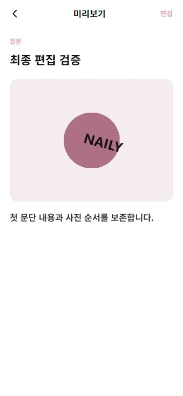

# 글쓰기 드래그·캔버스 편집 개편

검증일: 2026-10-04. 기존 작업 트리의 변경 사항을 보존하고 글쓰기와 이미지 장식 경로만 수정했다. 데이터베이스를 추가하지 않았으며 저장 대상은 기존 로컬 데모 세션이다.

## 변경 파일

| 파일 | 이번 변경 |
| --- | --- |
| `app/write.tsx` | 꾸미기 완료 결과만 소비, 취소 시 블록 원본 유지, URI만 있는 예전 이미지 편집 지원, 사용한 임시 결과 제거 |
| `app/image-decorator.tsx` | 사진 중심 캔버스, 문맥별 도구, 복제·삭제·레이어, 실행 취소/다시 실행, 완료 중복 방지 |
| `components/BlogEditor.tsx` | 사진 이동 핸들·삽입선·입력 잠금 연결, 직접 서식 도구, 기존 이동 메뉴 유지 |
| `components/EditorToolbar.tsx` | B·현재 크기·정렬과 간결한 크기 선택 행 |
| `components/DecoratedImage.tsx` | 이동·핀치·회전 제스처, 동일한 저장/미리보기 렌더링, 기존 장식 호환 |
| `hooks/usePhotoReorder.ts` | 길게 누르기, 드래그 세션, 가장자리 자동 스크롤, 취소·화면 이탈 정리 |
| `services/documentEditing.ts` | ID 기준 혼합 블록 재배치, 삽입 위치와 가장자리 속도 계산 |
| `services/decorationEditing.ts` | 좌표 변환, 레이어 정렬, 독립 복사, 제한된 히스토리 |
| `constants/typography.ts` | 명시적인 소제목 `bold:false`를 렌더링에도 반영; 미지정 소제목은 기존 굵기 유지 |
| `types/models.ts` | 장식의 선택 필드 `rotation`, `scale`, `layer`, `coordinateVersion` 추가 |
| `tests/writing.test.cjs` | 직접 서식, 이전 이동 메뉴, 꾸미기 취소·복귀 회귀 검사 |
| `tests/document-editing.test.cjs` | 드래그 세션·자동 스크롤·장식 변환·히스토리·저장/렌더링 검사 |
| `docs/writing-canvas-editor.md` | 이 보고서 |
| `docs/writing-canvas-preview.png` | 웹 375×812 미리보기 확인 이미지 |

`WritingTextInput`, `PostBlockRenderer`, 기존 게시글 저장·리액션 서비스의 구조는 유지했다. 기존 커뮤니티·예약 화면은 이번 작업에서 수정하지 않았다.

## 패키지

추가·변경 없음. 확인한 실제 설치 버전은 Expo 57.0.19, React Native 0.86.3, React 19.2.3, expo-image-picker 57.0.15, expo-haptics 57.0.3이다.

node_modules에는 gesture-handler 3.2.1과 reanimated 4.6.0도 간접 의존성으로 존재하지만 앱의 직접 의존성/제스처 루트로 설정되어 있지 않았다. 이번 구현은 기존 RN PanResponder와 requestAnimationFrame을 사용한다. UI 스레드 기반 Reanimated 구현은 아니며, JS 부하가 큰 긴 문서에서의 부드러움은 실기기로 확인해야 한다. 추가 네이티브 모듈이나 Babel 설정 변경은 없다.

## 사진 순서 이동

- 사진 우측 상단 44×44 핸들을 300ms 누르면 드래그가 활성화되고 Light 햅틱을 한 번 호출한다. 기존 실패를 흡수하는 햅틱 서비스를 재사용한다.
- 활성화 전에 8dp 이상 움직이면 대기를 취소한다. 짧은 터치·즉시 이동은 문서 스크롤에 양보한다. 텍스트 영역에는 길게 누르기 핸들러를 설치하지 않았다.
- 활성화 후에만 바깥 스크롤과 문단 입력·사진 액션을 잠근다. 이동 중 사진은 0.96배로 표시하고, 대상 블록 위에 삽입선을 표시한다.
- 모든 문단·소제목·구분선·사진의 실제 레이아웃을 사용한다. 손을 놓으면 최신 배열에서 ID 기준으로 한 번만 재배치한다. URI·비율·장식 데이터와 React key는 유지된다.
- 화면 상하 최대 64dp 구간에서 가장자리에 가까울수록 빨라지는 자동 스크롤을 적용했다. 최대 약 360dp/초이며 60/120Hz 프레임 시간으로 보정한다. 긴 프레임 뒤의 이동량과 콘텐츠 범위를 제한한다.
- 제스처 취소·반려·화면 blur·앱 비활성화·웹 pointercancel/창 blur에서 타이머와 RAF를 정리하고 배열을 변경하지 않는다. Android 뒤로가기는 드래그 중일 때 이동만 취소하고, 그 외에는 기존 뒤로가기에 양보한다.
- 자동 스크롤이 활성 드래그의 responder를 빼앗지 않게 했다. 두 번째 손가락이 들어오면 사진 순서 드래그는 취소한다.
- 기존 위로 이동·아래로 이동·꾸미기·삭제 메뉴를 유지했다. iOS 메뉴에서 꾸미기로 이동할 때는 Modal dismiss 이후 이동한다.
- 탄성/반복 애니메이션은 추가하지 않았다.

## 사진 꾸미기

이전의 사진 아래 긴 설정 폼을 상단 도구 / 사진 캔버스 / 선택 요소에 맞는 하단 도구로 바꿨다. 사용 가능한 영역에 원본 비율의 프레임을 맞춰 사진 전체가 들어가도록 표시하고, 바깥은 중립적인 어두운 배경으로 처리한다. SafeArea를 유지한다.

지원 도구:

- 여러 개의 텍스트, 기본 도형, 반짝임 이모지, 그라데이션 추가
- 요소 선택, 한 손가락 이동, 두 손가락 확대·축소와 회전
- 선택된 텍스트를 다시 누르거나 내용 수정 버튼으로 텍스트 입력
- 크기 18/24/30/38, 굵기, 글자색, 배경색·불투명도, 정렬
- 복제, 삭제, 맨 앞으로, 레이어 목록을 통한 겹친 요소 선택
- 제스처 대체용 상하좌우 이동·회전·확대/축소 버튼
- 실행 취소와 다시 실행

선택 테두리는 편집 중에만 보인다. 작은 요소에는 확장된 터치 영역과 레이어 목록을 제공한다. 화면 좌우 24dp에서는 요소가 responder를 선점하지 않으며, 시스템 제스처 설정은 변경하지 않았다. 요소 선택에 따라 캔버스가 움직이지 않도록 선택 시 열린 도구 행을 임의로 닫지 않는다.

휴지통 드롭은 구현하지 않았다. 회전·확대 중 캔버스 바깥으로 움직이는 동작을 삭제로 오인하지 않도록 명시적인 삭제 버튼을 사용한다. 자유 그리기는 기존 스키마에 선/획 모델과 캔버스 엔진이 없어서 이번 범위에서 제외했다. 외부 스티커 자산도 추가하지 않았으며 미구현 버튼은 없다.

## 좌표·호환·히스토리

- `x/y/width/height`는 사진 프레임 비율이다. 픽셀 이동량을 사진 너비/높이로 나누어 저장한다. 회전은 degree, scale은 0.35~3배, layer는 표시 순서다.
- 회전 중심이 사진 안에 남도록 위치를 제한한다. 긴 텍스트는 실제 측정한 높이를 반영한다. 요소끼리 겹칠 수 있다.
- 새 장식의 `coordinateVersion:2`는 390dp 기준 글자 크기·패딩·모서리 크기를 사진 너비에 비례해 렌더링한다. 꾸미기·작성·미리보기·상세·카드는 공통 DecoratedImage를 사용한다.
- 기존 장식은 rotation=0, scale=1, 배열 순서를 기본값으로 읽으며 예전 글자 배율 제한·패딩을 유지한다. 기존 데이터 전체를 변환하는 마이그레이션은 없다.
- 원본 URI를 유지하고 장식 메타데이터만 저장한다. 꾸미기 완료 시 합성 이미지나 재인코딩 파일을 생성하지 않는다.
- 히스토리는 화면 안의 past/present/future 구조이고 최대 40개 이전 상태를 보관한다. 드래그 중에는 미리보기만 바꾸고 손을 놓을 때 한 번 기록한다. 취소하면 이전 상태로 되돌린다. undo 이후 새 변경은 redo를 비운다.
- 완료 때만 작성 화면의 임시 결과를 갱신한다. 취소는 원본 참조를 유지하고 작성 화면은 이를 변경 결과로 적용하지 않는다. 완료 중복 호출은 ref로 차단한다. 제목·본문·태그·카테고리·블록 순서는 별도 상태로 유지된다.

## 직접 글자 서식

하단에서 B와 현재 크기를 바로 표시한다. 선택 문단의 굵기 상태는 선택 배경 및 접근성 selected 상태로 나타낸다. 크기 버튼은 작은 선택 행을 연다. 본문은 기존 14/16/18에 실제 기본값 15를 함께 표시하고, 소제목은 18/20/24를 사용한다. 기존에 저장된 22 등의 크기도 현재 값 그대로 표시하며 자동 변환하지 않는다.

적용 단위는 **현재 문단/소제목 블록 전체**다. 일부 선택한 글자에만 적용되는 리치 텍스트 기능은 아니다. 크기 선택 행에 이를 안내한다. 사진을 선택하면 글자 도구는 사라지고 사진 액션을 사용한다.

서식 변경은 Keyboard.dismiss나 본문 재할당·강제 selection 변경을 하지 않는다. 기존 입력 인스턴스로 포커스를 복원하며, 기존 자동 높이 컴포넌트가 변경된 글자 크기/줄 높이를 재측정한다. 한글 IME의 실기기 조합 중 동작은 별도 확인 대상이다.

## 검증 결과

- `npm run typecheck`: 통과.
- `node --test tests/*.test.cjs`: 46개 통과, 실패 0.
- 변경한 tracked 파일의 `git diff --check`: 통과.
- lint: 프로젝트에 lint 스크립트와 설정이 없어 별도 실행하지 않았다.
- Expo 웹 개발 서버에서 확인했으며, 네이티브 빌드나 실기기 실행을 했다고 주장하지 않는다.

자동 검사에는 혼합 블록 재배치와 동일 ID/장식 유지, 짧은 이동 취소, 300ms 활성화, 중복 release 방지, 종료/blur/뒤로가기 취소, 자동 스크롤 범위, 좌표 크기 독립성, 핀치/회전 계산, 기존 장식 복사, 40개 히스토리 제한, undo 후 redo 초기화, 실제 꾸미기 화면 콜백의 취소/완료, 문단별 서식 독립성, 기존 이동 메뉴, 저장 및 PostBlockRenderer 전달을 포함한다. 훅/콜백 테스트는 실제 터치 하드웨어의 검증을 대체하지 않는다.

웹에서 확인한 내용:

- 320×740 및 375×812 글쓰기·꾸미기 레이아웃
- 본문 18→14 변경 때 높이 216→147px 감소, 포커스·본문 유지
- 로컬 사진 추가, 텍스트 입력·색상·회전·확대
- 장식을 실제 마우스로 드래그하고 한 번의 undo/redo로 복원
- 복제·삭제·삭제 undo
- 사진을 기존 이동 메뉴로 본문 앞에 배치하고 미리보기·등록 후 상세에서 순서/장식/굵기 유지
- 기존 post-1 수정 화면의 22px 소제목, 그라데이션·제목 장식 복원
- 기존 장식을 회전한 뒤 꾸미기를 취소하고 다시 열었을 때 rotation=0 유지
- 짧은 사진 핸들 드래그에서 순서 변경이 발생하지 않음
- 조사한 브라우저 오류 로그에 런타임 error 없음. 공통 코드에서 사용하는 shadow* 및 pointerEvents prop의 RN Web deprecation 경고는 관찰됨.

브라우저 제어 도구가 길게 누른 상태를 유지하는 입력과 두 손가락 입력을 제공하지 않아, 사진의 300ms 길게 누르기 이후 실제 드래그·긴 문서 자동 스크롤·실제 핀치/회전은 UI 검증을 완료하지 못했다. 이 부분은 로직 테스트가 통과한 구현이며 아래 기기 점검이 필요하다.

## iOS·Android 추가 점검

1. 300ms 핸들 길게 누르기 → Light 햅틱 1회 → 문단/소제목/구분선 전후 이동 → release 시 1회 반영.
2. 즉시 세로 이동은 스크롤, 텍스트 길게 누르기는 OS 선택, 드래그 중 스크롤 잠금과 취소 후 해제.
3. 화면 상하 자동 스크롤, 긴 문서/여러 사진의 프레임 부드러움, 60/120Hz 기기.
4. iOS 가장자리 뒤로가기와 Android 시스템 뒤로가기, 앱 백그라운드 복귀.
5. 핀치와 회전 동시 조작, 두 번째 손가락 추가/해제 시 위치 튐 여부, 캔버스 경계·겹친 레이어 선택.
6. 한글 조합 중 B/크기 변경, 중간 커서·선택 영역 유지, 키보드 열림/닫힘과 문단 높이 증가/감소.
7. 시스템 글자 크기 확대, VoiceOver/TalkBack 메뉴 대체 조작, SafeArea와 작은 화면.
8. iOS 시트 종료 후 꾸미기 진입 및 취소/완료 왕복, URI만 있는 예전 사진 편집.

